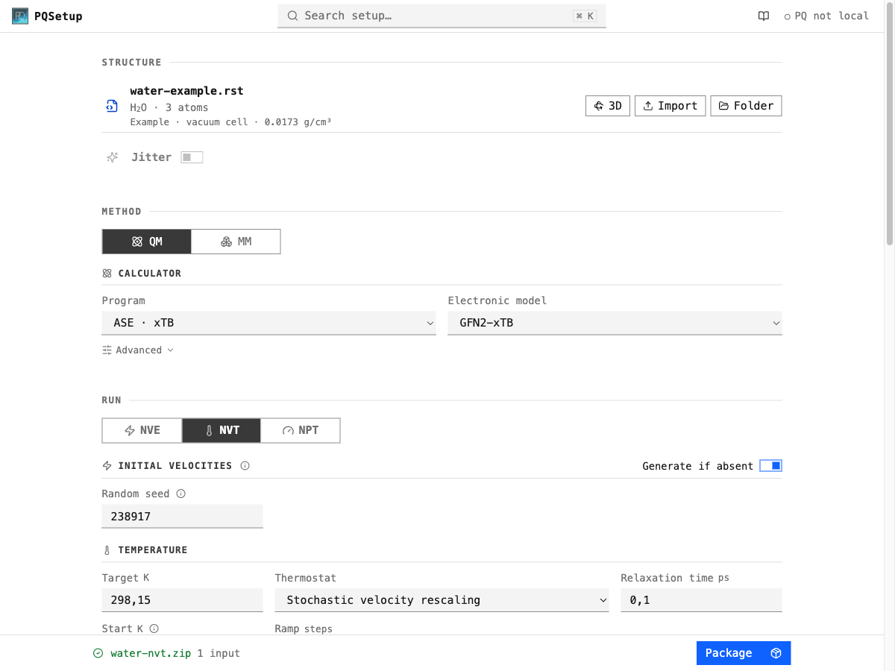

#  PQSetup

Prepare and inspect portable input packages for [PQ](https://github.com/MolarVerse/PQ) in your browser.



## Start

Python 3.11+; PQSetup targets the stable PQ v1.1.0 input format.

```bash
python3 -m venv .venv
source .venv/bin/activate
python -m pip install MolarVerse-PQSetup
pqsetup
```

| Step | Use |
| --- | --- |
| Structure and method | Import a structure; choose QM or MM and its required files |
| Run plan | Set ensemble, coupling, timestep and sampling length |
| Review and package | Inspect **Review** and **Inputs**, then **Package** |

For a prepared AMBER system, install `MolarVerse-PQSetup[amber]` on Python
3.12 or newer. Choose **Import → AMBER system**, then select the matching
topology (`.prmtop` or `.parm7`) and restart (`.inpcrd` or `.rst7`). A successful import replaces
the current structure and setup files. Select files from the same system:
matching atom counts alone do not verify atom order.

The bundled water system is a vacuum demonstration. Check the physical model,
cell and sampling before research use; input validation does not establish convergence.

[Visual guide](https://molarverse.github.io/PQSetup/getting-started.html) ·
[Settings](https://molarverse.github.io/PQSetup/reference/settings.html) ·
[Validation](https://molarverse.github.io/PQSetup/validation.html) ·
[Run the package](https://molarverse.github.io/PQSetup/run-packages.html) ·
[Cluster / home VPN](https://molarverse.github.io/PQSetup/remote-access.html)
